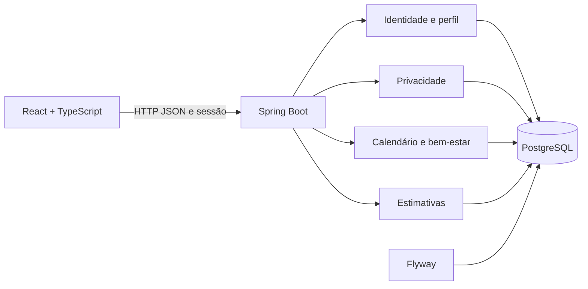

# Kali

**Acompanhamento menstrual, bem-estar e autoconhecimento com privacidade por padrão.**

[](https://github.com/HellenLatiffa/kali/actions/workflows/ci.yml)


Projeto full stack de portfólio com calendário menstrual, sintomas, diário de bem-estar e estimativas pessoais. O desenvolvimento prioriza autorização por titular, consentimento explícito e controle dos próprios dados.

## Funcionalidades

- Cadastro, login e logout com sessões persistidas no servidor.
- Calendário mensal com registros de fluxo, escape e início menstrual.
- Registro de sintomas e intensidade percebida.
- Diário opcional de humor, estresse, energia e sono.
- Dashboard com estimativa baseada na mediana dos intervalos registrados explicitamente.
- Consentimento versionado, revogação, exportação e exclusão de conta.

**Estado:** MVP em desenvolvimento, com funcionalidades integradas e testes automatizados. A estimativa é incerta, não diagnóstica e não deve ser usada como contraceptivo. Preparação para produção, recuperação de email e testes automatizados em PostgreSQL ainda estão no roadmap.

## Engenharia

| Área | Implementação |
| --- | --- |
| Backend | Java 21, Spring Boot, Spring Security e Bean Validation |
| Interface | React, TypeScript, Vite e CSS responsivo |
| Persistência | PostgreSQL, JPA/Hibernate e migrations Flyway |
| Autenticação | Spring Session JDBC, BCrypt, cookies HttpOnly e CSRF |
| Privacidade | Consentimento nas rotas de saúde e isolamento por identidade autenticada |
| Qualidade | JUnit, Spring Boot Test, H2, Oxlint e build TypeScript |

O backend é um monólito modular organizado por domínio. DTOs definem os contratos HTTP; migrations versionam o banco e o Hibernate valida o schema. Contas distintas atendem execução e migrações.



## Executar localmente

Fluxo documentado: Windows, PowerShell, JDK 21, Node.js 24 e PostgreSQL 17. Maven é fornecido pelo Wrapper.

```powershell
git clone https://github.com/HellenLatiffa/kali.git
cd kali
# Ajuste se seu JDK estiver em outro diretório:
$env:KALI_JDK21_HOME = 'C:\caminho\para\jdk-21'
.\scripts\check-environment.ps1
cd frontend
npm ci
cd ..
```

Configure banco, roles e credenciais conforme o [guia local](docs/LOCAL_DEVELOPMENT.md). Em uma instalação nova, `scripts/provision-postgres.ps1` solicita credenciais protegidas e cria o `.env`; se as roles já existem, use `scripts/configure-postgres-env.ps1`. Consulte `.env.example` para as variáveis necessárias.

Inicie em dois terminais:

```powershell
.\scripts\start-backend.ps1
```

```powershell
.\scripts\start-frontend.ps1
```

Interface: `http://localhost:5173` · Healthcheck: `http://localhost:8080/actuator/health`.

O Docker Compose existente é legado e ainda não foi validado com as roles separadas; siga o procedimento PostgreSQL documentado.

## Validação

```powershell
.\scripts\test.ps1
```

Executa testes dos utilitários PowerShell, `mvn clean verify`, lint e build de produção do frontend. Os testes Java usam H2 e dados sintéticos; a integração em PostgreSQL tem validação local separada. O workflow de CI executa essas verificações em Windows com Java 21 e Node.js 24.

## Documentação

- [Ambiente e execução local](docs/LOCAL_DEVELOPMENT.md)
- [Arquitetura](docs/ARCHITECTURE.md) e [modelo de dados](docs/DATA_MODEL.md)
- [API](docs/API.md) e [segurança](docs/SECURITY.md)
- [Requisitos](docs/REQUIREMENTS.md), [estado verificado](docs/PROJECT_STATUS.md) e [roadmap](docs/ROADMAP.md)
- [Como contribuir](CONTRIBUTING.md)

## Organização

```text
backend/    API, regras de negócio, migrations e testes
frontend/   Interface React e estilos
docs/       Decisões, contratos e planejamento
scripts/    Execução, provisionamento e verificações
.github/    Integração contínua e modelo de pull request
```

## Autoria

Desenvolvido por [Hellen Latiffa](https://github.com/HellenLatiffa).
